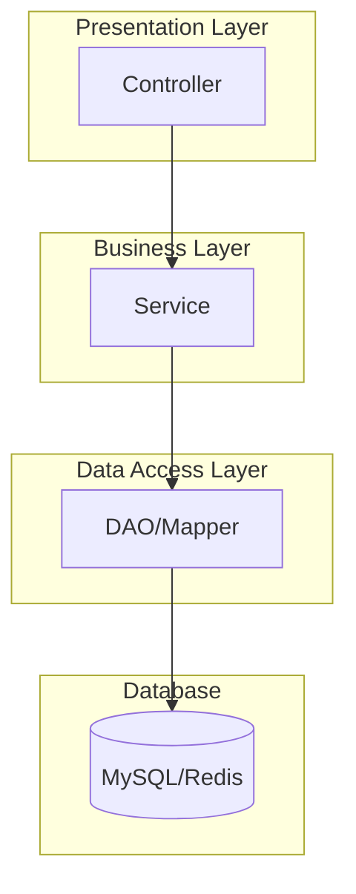
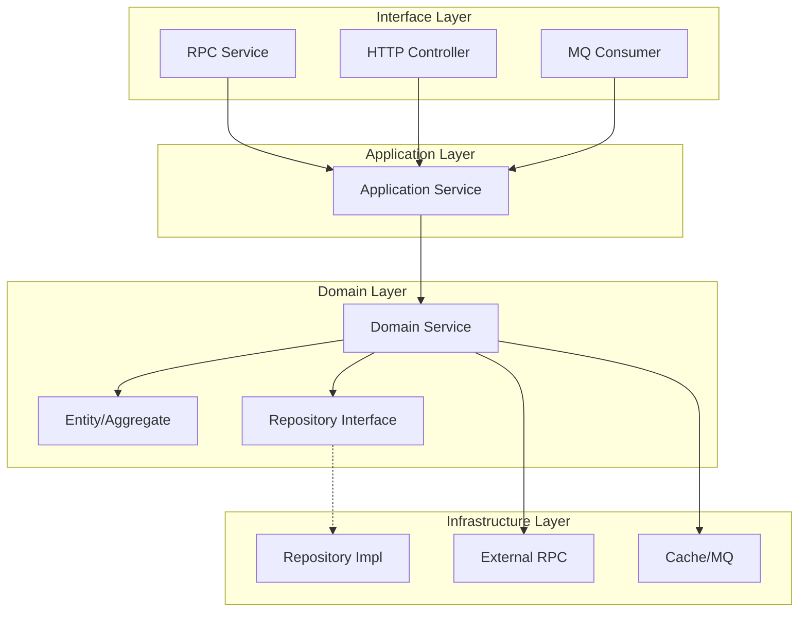
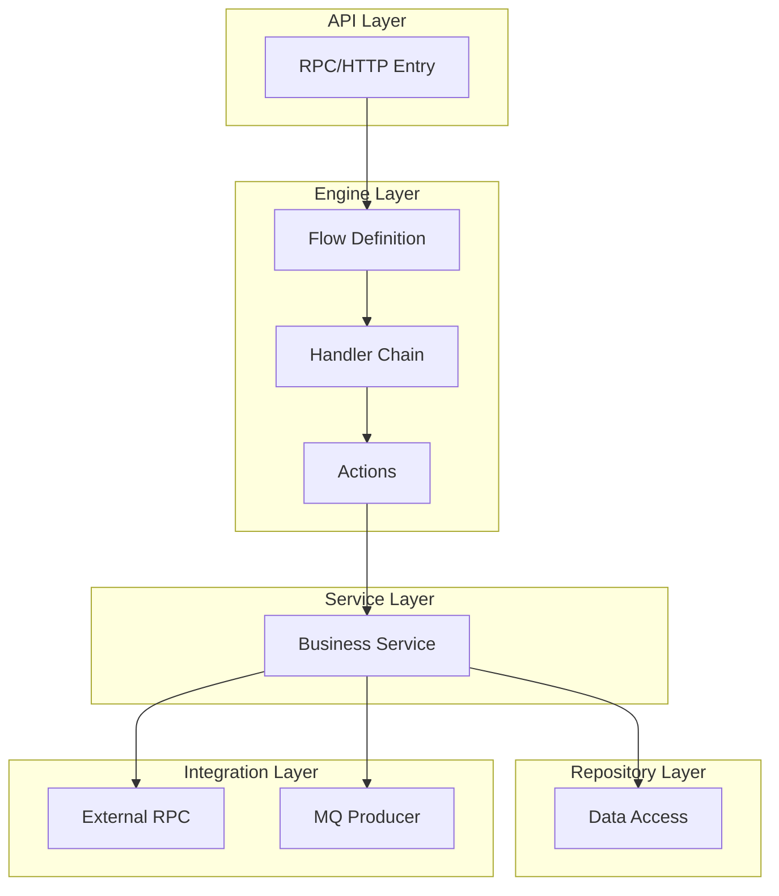
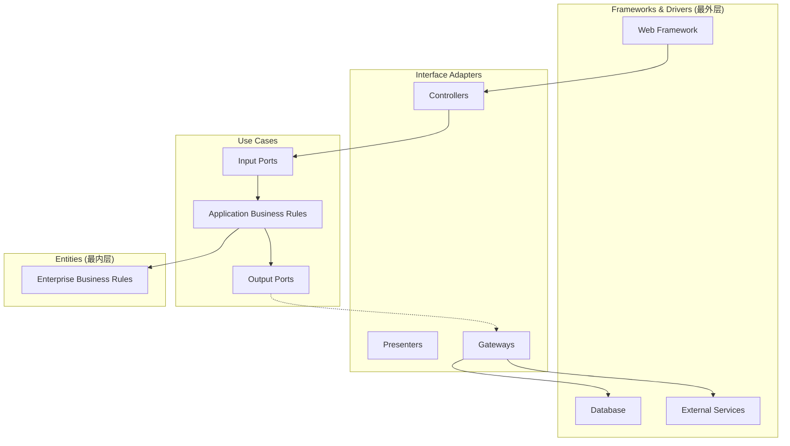
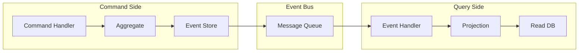

# 架构风格选择指南
---
## 架构风格选择指南
> ⚠️ **重要**：架构风格必须根据项目实际情况选择，以下提供多种架构模式供参考
### 架构风格对比
| 架构风格 | 适用场景 | 核心特点 | 分层结构 |
|---------|---------|---------|---------|
| **传统三层架构 (MVC)** | 简单业务、快速开发 | Controller → Service → DAO | 3层 |
| **DDD 分层架构** | 复杂业务领域、需要领域建模 | Interface → Application → Domain → Infrastructure | 4层 |
| **整洁架构 (Clean)** | 高内聚低耦合、依赖倒置 | Entities → Use Cases → Interface Adapters → Frameworks | 4层同心圆 |
| **六边形架构 (Hexagonal)** | 多端口适配、易于测试 | Core Domain ← Ports ← Adapters | 核心+端口+适配器 |
| **引擎驱动架构 (规则引擎)** | 规则引擎、流程编排 | Engine → Handler → Action | 引擎+处理器+动作 |
| **事件驱动架构 (EDA)** | 解耦、异步处理、高并发 | Producer → Event Bus → Consumer | 事件发布/订阅 |
### 架构选择决策树
```yaml
architecture_selection:
  question_1: "项目是否已有既定架构风格？"
  if_yes: "沿用现有架构风格"
  if_no:
    question_2: "业务复杂度如何？"
    simple: "传统三层架构 (MVC)"
    medium: "DDD 分层架构"
    complex: "整洁架构 / 六边形架构"
    
  special_cases:
    - condition: "使用规则引擎"
      architecture: "引擎驱动架构"
    - condition: "大量异步消息处理"
      architecture: "事件驱动架构"
    - condition: "需要支持多种外部系统接入"
      architecture: "六边形架构"
```
---
## 架构模式模板库
### 模式A：传统三层架构 (SpringMVC / 经典三层)
**适用场景**：简单 CRUD 业务、快速迭代、团队熟悉度高
**分层结构**：
```
├── controller          # 控制器层：接收请求、参数校验、返回响应
│   └── XxxController
├── service             # 服务层：业务逻辑
│   ├── XxxService (接口)
│   └── impl/XxxServiceImpl
├── dao                 # 数据访问层：数据库操作
│   └── XxxDao / XxxMapper
├── entity              # 实体层：数据库映射对象
│   └── XxxEntity
├── dto                 # 数据传输对象
│   ├── XxxRequest
│   └── XxxResponse
└── common              # 公共模块
    ├── constants
    ├── enums
    └── utils
```
**架构图**：

**调用流程**：
```
Controller → Service → DAO → Database
     ↓           ↓        ↓
   DTO        Entity   Entity
```
---
### 模式B：DDD 分层架构 (领域驱动设计)
**适用场景**：复杂业务领域、需要领域建模、团队有 DDD 经验
**分层结构**：
```
├── interface               # 接口层：对外暴露的接口
│   ├── rpc                 # RPC 服务
│   ├── http                # HTTP 控制器
│   ├── mq                  # MQ 消费者
│   └── schedule            # 定时任务
│
├── application             # 应用层：用例编排
│   ├── service             # 应用服务（编排领域服务）
│   ├── dto                 # 数据传输对象
│   └── assembler           # 对象转换器
│
├── domain                  # 领域层：核心业务逻辑
│   ├── {aggregate}         # 聚合根
│   │   ├── entity          # 实体
│   │   ├── valueobject     # 值对象
│   │   ├── repository      # 仓储接口
│   │   └── service         # 领域服务
│   └── event               # 领域事件
│
├── infrastructure          # 基础设施层：技术实现
│   ├── repository          # 仓储实现
│   ├── rpc                 # 外部 RPC 客户端
│   ├── mq                  # MQ 生产者
│   ├── cache               # 缓存
│   └── config              # 配置
│
└── common                  # 公共模块
```
**架构图**：

**依赖规则**：
```
Interface → Application → Domain ← Infrastructure
                            ↑
              Domain 层不依赖任何外层
              Infrastructure 实现 Domain 定义的接口
```
---
### 模式C：引擎驱动架构 (规则引擎)
**适用场景**：使用规则引擎、流程编排场景
**分层结构**：
```
├── api                     # API 入口层
│   ├── rpc                 # RPC 服务
│   └── http                # HTTP 控制器
│
├── engine                  # 引擎层：流程编排
│   ├── flow                # 流程定义
│   │   └── XxxFlow.java    # 流程配置
│   ├── handler             # 处理器
│   │   └── XxxHandler.java # 节点处理器
│   └── action              # 动作
│       └── XxxAction.java  # 原子动作
│
├── service                 # 服务层：业务逻辑
│   └── XxxService
│
├── repository              # 仓储层：数据访问
│   ├── XxxRepository
│   └── impl/
│
├── integration             # 集成层：外部系统
│   ├── rpc                 # 外部 RPC
│   └── mq                  # 消息队列
│
└── model                   # 模型层
    ├── entity              # 实体
    ├── dto                 # DTO
    └── context             # 流程上下文
```
**架构图**：

**引擎流程示例**：
```
┌─────────────────────────────────────────────────────────┐
│                    Flow: OrderCreateFlow                │
├─────────────────────────────────────────────────────────┤
│  ┌─────────┐   ┌─────────┐   ┌─────────┐   ┌─────────┐ │
│  │ Validate│ → │ Enrich  │ → │ Execute │ → │ Notify  │ │
│  │ Handler │   │ Handler │   │ Handler │   │ Handler │ │
│  └─────────┘   └─────────┘   └─────────┘   └─────────┘ │
│       ↓             ↓             ↓             ↓      │
│  ┌─────────┐   ┌─────────┐   ┌─────────┐   ┌─────────┐ │
│  │ParamChk │   │QueryUser│   │CreateOrd│   │SendMsg  │ │
│  │ Action  │   │ Action  │   │ Action  │   │ Action  │ │
│  └─────────┘   └─────────┘   └─────────┘   └─────────┘ │
└─────────────────────────────────────────────────────────┘
```
---
### 模式D：整洁架构 (Clean Architecture)
**适用场景**：高内聚低耦合要求、依赖倒置、易于测试
**分层结构（同心圆）**：
```
├── entities                # 最内层：企业业务规则
│   └── XxxEntity
│
├── usecases                # 用例层：应用业务规则
│   ├── XxxUseCase
│   └── port                # 端口定义
│       ├── input           # 输入端口（用例接口）
│       └── output          # 输出端口（仓储接口）
│
├── adapters                # 适配器层：接口适配
│   ├── controller          # 输入适配器
│   ├── presenter           # 输出适配器
│   └── gateway             # 数据网关
│
└── frameworks              # 框架层：外部框架和驱动
    ├── web                 # Web 框架
    ├── db                  # 数据库
    └── external            # 外部服务
```
**架构图**：

**依赖规则**：
```
依赖方向：外层 → 内层
Frameworks → Adapters → Use Cases → Entities
         ↑
    依赖只能指向内层
    内层不知道外层的存在
```
---
### 模式E：事件驱动架构 (EDA)
**适用场景**：解耦、异步处理、高并发、CQRS
**分层结构**：
```
├── api                     # API 入口
│   └── XxxController
│
├── command                 # 命令端（写）
│   ├── handler             # 命令处理器
│   └── aggregate           # 聚合
│
├── query                   # 查询端（读）
│   ├── handler             # 查询处理器
│   └── projection          # 投影
│
├── event                   # 事件
│   ├── domain              # 领域事件
│   ├── publisher           # 事件发布
│   └── subscriber          # 事件订阅
│
├── saga                    # 长事务编排
│   └── XxxSaga
│
└── infrastructure          # 基础设施
    ├── eventstore          # 事件存储
    ├── messagebus          # 消息总线
    └── projection          # 投影存储
```
**架构图**：

