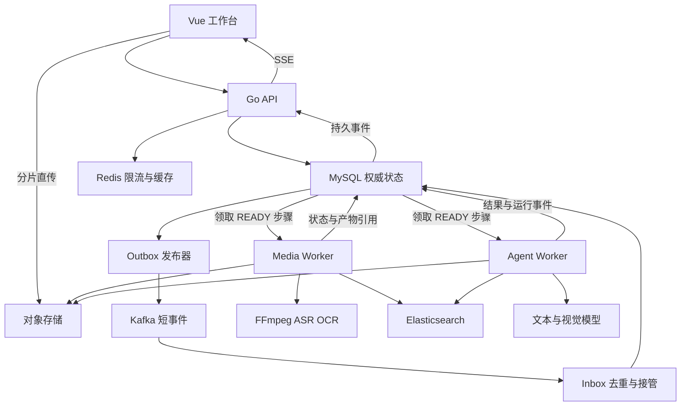

# 视频知识分析平台技术实现方案

版本：V1.0 设计稿
日期：2026-10-22
目标：以 Go 为主要语言，完成一个可以演示、测试和解释设计取舍的视频 Agent 项目，同时覆盖后端开发与 Agent 工程岗位能力。

本文是待实现的技术方案。文中的并发数、超时、数据规模和验收门槛均是初始配置或验收目标，不代表已经取得的性能结果。项目参考 DOVideo-AI 的业务思路，但本方案的 Go 实现、消息语义和恢复机制需要独立开发验证。

## 1. 产品定义与范围

### 1.1 用户价值

用户上传课程或技术分享视频，系统生成章节摘要，并支持围绕视频提问。回答可以引用字幕和画面证据，点击引用可跳转到原视频时间位置。

典型问题：

- “这一节讲了哪些内容？给我章节和起止时间。”
- “视频中的二叉树左旋，旋转前后节点连接关系发生了什么变化？”
- “前后两种实现为什么性能不同？分别在哪段讲解？”
- “这段视频是否解释了 Redis 集群故障转移？”如果没有相关证据，应明确说明。

视频处理形成可复用内容，同一个视频的后续提问直接使用已有内容，不重复执行完整转写和抽帧。

### 1.2 V1 必须交付

1. 用户登录、视频列表、分片上传和断点续传。
2. 视频元数据探测、音频提取、ASR、关键帧、OCR、带时间戳的内容切片。
3. Elasticsearch 关键词与向量混合检索。
4. Eino 单 Agent 的检索、片段阅读、按需看图、结构化回答与引用校验。
5. 章节摘要、多轮问答、SSE 事件展示与断线后查询。
6. MySQL 持久任务状态、Kafka 事件分发、有限重试、阶段复用、过期执行结果拒绝。
7. Agent 配置版本、运行日志、成本记录、离线效果评测和故障测试。
8. Docker Compose 启动、演示数据导入说明与操作文档。

### 1.3 后续扩展

etcd 多调度器选主、MCP 工具接入、多视频问答、独立重排模型、Kubernetes 部署可以后续增加。V1 不实现通用工作流编辑器、任意代码 Agent、视频剪辑平台或模型训练系统。在线视频链接下载也留在后续；V1 的入口是本地文件上传。

### 1.4 开发边界

- 首批内容：5 个视频和 30 道人工核验问题；完整验收扩到 15～20 个视频、约 100 道问题。
- 初始限制：单文件不超过 2 GiB、单视频不超过 120 分钟；这些是产品配额，可配置。
- 视频格式：先支持 MP4 容器中常见的 H.264/AAC 组合。其他已上传格式经过 ffprobe 检查；需要播放兼容转换时生成独立预览文件。
- 输入语言：中文和英文。语音模型、OCR 模型需要显式配置语言。
- 模型推理由服务 API 提供；V1 不要求本地 GPU。
- 用户数据按 owner_id 隔离。V1 不实现企业组织、跨组织共享与复杂 RBAC。

## 2. 参考依据与技术选择

### 2.1 岗位要求映射

以下是公开职位样本，不是整个招聘市场的频率统计，也不代表用户符合这些岗位的毕业年份或当前仍可投递。

| 岗位样本 | 原文体现的能力 | 本项目对应实现 |
|---|---|---|
| [波克 2027 届 Golang 服务器开发](https://boke.jobs.feishu.cn/581609/position/7674939947783538950/detail) | Go 并发、数据库基础、MySQL/Redis；Kafka、etcd、容器等作为加分项 | 有界 Worker、事务、索引、缓存、事件分发、故障恢复 |
| [思必驰 Agent 开发工程师](https://aispeech.zhiye.com/campus/jobs?queryId=a1468537-9863-4599-905e-4a9a655510d0) | 工具调用、任务规划、上下文、RAG、流式输出、长任务状态和失败恢复 | 工具接口、证据检索、预算约束、SSE、运行恢复 |
| [美团 AI Agent 开发工程师](https://zhaopin.meituan.com/web/position/detail?jobShareType=1&jobUnionId=4697317646&share_source=cplink) | Agent 工程化、框架实践、评估与优化 | Eino 应用、基线对照、引用与成本评测 |

选择 Eino 是基于用户的 Go 技术方向，不表示上述 JD 均要求 Eino。若目标岗位硬性要求 Python/LangGraph，需要补充对应能力；不在同一个 V1 中维护两套 Agent 框架。

### 2.2 与 DOVideo-AI 的关系

[DOVideo-AI README](https://github.com/Xiaoc7r/DOVideo-AI#readme)描述了上传、语音与 OCR 处理、统一视频片段、证据反馈、检查点和流式交互。本方案借鉴这些业务组织方式，采用 Go 实现，并明确消息接管、执行租约、证据版本和验证方法。README 不能替代源码审计或运行验证。

Java 框架迁移与中间件替换分开处理：Spring Boot/MyBatis-Plus/LangChain4j 对应 Go API、SQL 数据访问和 Eino；RocketMQ 改 Kafka、Qdrant 改 ES 则是独立的设计决策，需要重新测试确认、重试与检索行为。

### 2.3 确定的主技术栈

| 技术 | 选择与职责 | 引入时间 |
|---|---|---|
| Go + go-zero | API、后台任务、鉴权、限流接入、配置加载 | 第一阶段 |
| database/sql + sqlx | 明确编写事务、条件更新和队列领取 SQL | 第一阶段 |
| Eino ADK | 单 Agent 工具循环、消息组织、运行事件 | 第二阶段 |
| MySQL 8.4 | 业务和任务状态权威来源，InnoDB | 第一阶段 |
| Redis 8 系列 | 限流、短期元数据缓存；业务可从 DB 重建 | 可靠性阶段 |
| Kafka 4 系列，KRaft | 短事件分发；Go 客户端选 franz-go | 可靠性阶段 |
| Elasticsearch 9 系列 | BM25、dense_vector、权限和版本过滤 | 第二阶段 |
| SeaweedFS S3 接口 | 本地视频与产物存储 | 第一阶段 |
| 腾讯云 COS 适配器 | 云 ASR 音频暂存；远程部署时可承载全部媒体 | 第一阶段 |
| FFmpeg / ffprobe | 媒体探测、音频提取、预览转换和抽帧 | 第一阶段 |
| Tesseract chi_sim + eng | 基础画面文字识别 | 第一阶段 |
| ASR API | 带时间戳的转写；优先异步文件识别接口 | 第一阶段 |
| 文本 / 视觉 / Embedding API | 分别负责推理、画面理解、文本向量化 | 第二阶段 |
| Vue 3 + Vite | 工作台、视频播放器、证据与进度展示 | 第一阶段 |
| OpenTelemetry + Prometheus/Grafana | Trace、指标、告警；结构化日志用 Go slog | 完整验收前 |
| Docker Compose | 本地完整系统与测试环境 | 第一阶段 |

版本表给出兼容线，实施前用一次最小连通测试确定具体补丁版本、镜像 digest 和 Go module 版本并入库；镜像、模型和依赖不能用浮动 latest 作为验收基线。Eino 的具体构造 API 以所锁版本为准。

S3 存储层使用明确接口隔离供应商。SeaweedFS 提供 S3 能力，参考[官方说明](https://github.com/seaweedfs/seaweedfs)。此前提过的 MinIO 社区仓库现已归档，不作为新项目默认依赖，见[仓库状态](https://github.com/minio/minio)。

## 3. 总体架构与代码组织

### 3.1 一个仓库，四种逻辑角色

| 角色 | 职责 | V1 部署方式 |
|---|---|---|
| api | 用户接口、上传授权、Agent 配置、SSE | 独立进程 |
| coordinator | Outbox 发布、Kafka 消费接管、步骤推进、重试与租约回收 | 独立后台进程 |
| media-worker | 音频、ASR、OCR、切片与建索引 | Worker 进程，media 模式 |
| agent-worker | 问答、摘要、看图工具、结果校验 | 同一 Worker 程序，agent 模式 |

早期可以由一个 worker 命令同时启用后台协调与两个执行池；完成版用不同启动参数独立部署。逻辑角色共用同一代码仓库和清晰的 repository 层，不是四套独立微服务。V1 不额外增加内部 RPC 网络；未来跨语言或独立数据所有权时再引入 gRPC。



### 3.2 仓库结构

```text
video-agent/
  cmd/api/                 API 启动
  cmd/coordinator/         消息与调度后台
  cmd/worker/              media / agent 两种模式
  internal/api/            HTTP handler、鉴权、错误映射
  internal/domain/         领域对象、状态、错误码
  internal/repository/     MySQL SQL 与事务
  internal/upload/         分片会话和对象完成核验
  internal/workflow/       固定阶段依赖、重试、租约
  internal/media/          ffprobe、音频、抽帧、OCR
  internal/retrieval/      ES mapping、召回、RRF、证据组装
  internal/agent/          Eino runner、工具、引用校验
  internal/provider/       ASR、Embedding、LLM、VLM 适配器
  internal/storage/        S3 与云存储接口
  internal/event/          Outbox、Kafka、Inbox、SSE 事件
  internal/observability/  Trace、指标、结构化日志
  web/                    Vue 前端
  migrations/             SQL 迁移
  configs/                非敏感示例配置
  deploy/                 Compose 与监控配置
  eval/                   评测脚本、人工标注和清单
  tests/integration/      关键端到端与故障测试
  docs/                   设计与运行手册
```

## 4. 两条业务链路与版本边界

### 4.1 视频预处理

```text
完成上传 → PROBE
              ├→ EXTRACT_AUDIO → ASR
              └→ EXTRACT_FRAMES → OCR
                    ↓ 两分支达到可接受状态
                BUILD_SEGMENTS
                    ↓
                BUILD_INDEX
                    ↓
          发布该视频的 active_content_version
```

ASR/OCR 是数据处理步骤，使用固定流程，不交给模型决定媒体命令。章节摘要是索引完成后的独立分析任务，失败不会让已经可检索的视频重新变为不可用。

OCR 经过重试仍失败时，可由流程明确标记 SKIPPED，并将版本标记为 TEXT_ONLY；用户看到能力降级。V1 对有语音的视频要求 ASR 成功，否则预处理失败。静音、无有效语音的视频返回 UNSUPPORTED_NO_SPEECH；纯视觉视频支持作为后续能力，不把空字幕当成功处理。

### 4.2 单次问答

仅创建会话时读取当前 active_content_version 与选择的 Agent 版本。创建问答时从 sessions.video_version_id / agent_version_id 取得会话固定版本，复制到 agent_run → 排队执行 → 检索与读取证据 → 按需看图 → 生成结构化回答 → 引用校验与有限修正 → 发布最终结果。

用户后续追问创建新的 run，同一会话 V1 只允许一个活动 run，避免历史消息并发覆盖。再次点击同一提交按钮由幂等键返回原 run；新问题使用新的幂等键。

### 4.3 版本规则

- 视频内容版本不可变。修改转写、切片参数或模型时创建新版本，不覆盖旧版本。
- 视频行保存 active_content_version，只有索引构建完成并确认可检索后才切换。
- run 固定视频版本、Agent 版本、Embedding 版本、检索配置版本，执行中不跟随后台配置变化。
- 复用键包含 owner_id、video_id/content_hash、处理阶段、输入产物版本和配置 hash。
- 复用范围限当前用户。不同用户上传同一文件不自动共享可见内容或结果。
- 模型更换但向量维度相同，也不能混用不同向量空间；模型或预处理版本变更需重建索引。

## 5. 视频上传与对象生命周期

### 5.1 上传步骤

1. POST /v1/uploads：校验用户配额、文件大小、声明类型，创建视频草稿和上传会话。
2. 后端调用对象存储 CreateMultipartUpload；创建成功后保存 storage_upload_id。若存储创建成功但 DB 保存失败，后台清理孤立上传。
3. POST /v1/uploads/{id}/part-urls：为指定 part_number 签发短期 URL。
4. 浏览器以 8 MiB 分片、最多 3 个并行请求上传。最后一片可小于分片大小。
5. GET /v1/uploads/{id}/parts：后端从对象存储 ListParts 获取实际已完成部分，作为续传依据。
6. POST /v1/uploads/{id}/complete：后端核验分片列表与会话归属，完成合并并 HeadObject 验证对象。
7. 同一 DB 事务中把会话置 COMPLETED、视频置 PROCESSING，创建预处理 job 和首个步骤事件。
8. 完成合并成功但 DB 事务失败时，重试先检查该对象，执行同一幂等完成事务；不要求客户端重新上传。

对象存储 multipart 的 ETag 不一定是整文件 MD5。校验采用供应商支持的 checksum；需要计算内容 hash 时由受控流式校验完成，不把前端声明 hash 当作真实性依据。[S3 官方说明](https://docs.aws.amazon.com/AmazonS3/latest/userguide/mpuoverview.html)

### 5.2 上传状态与对象路径

上传状态：INITIATING → UPLOADING → COMPLETING → COMPLETED；异常可进入 ABORTED 或 EXPIRED。COMPLETING 可由后台对账恢复。

```text
users/{owner_id}/videos/{video_id}/source/original
users/{owner_id}/videos/{video_id}/versions/{content_version}/
    attempts/{step_id}/{attempt_no}/audio/...
    attempts/{step_id}/{attempt_no}/frames/...
    attempts/{step_id}/{attempt_no}/transcript.json
users/{owner_id}/runs/{run_id}/attempts/{attempt_no}/answer.json
```

每次执行写独立对象路径，成功者在 DB 发布产物引用，消费者只读已发布引用。最终路径不是多个 Worker 共同覆盖的固定文件。

### 5.3 生命周期

- 过期未完成上传：后台调用 AbortMultipartUpload，再更新会话。
- 无 DB 引用的尝试产物：保留 24 小时排障后清理；该保留期为配置值。
- 用户删除视频：先软删除并阻止新访问，取消活动任务，再异步清理索引和对象。
- 已签发的下载 URL 无法靠删除 DB 状态即时撤回，因此采用短时效；删除后不再签发新 URL。
- 视频播放请求的签名 URL 过期时，前端重新申请并恢复当前位置。预览与证据链接由后端根据 asset_id 签发。

## 6. 媒体处理与时间轴

### 6.1 PROBE

使用 ffprobe 读取时长、分辨率、音轨、编码、容器与时间基准，验证真实媒体属性。记录原始 start_time 与到“播放器从 0 开始”的归一化映射。后续字幕、抽帧和播放器跳转统一使用归一化毫秒时间。

如果生成预览视频，保留原有时间关系；若转换改变起点或时长，保存映射，不能直接混用两个文件的时间戳。

### 6.2 音频与 ASR

- 按 ASR 服务要求转换采样率、声道和编码，接口适配器暴露这些约束。
- 优先使用单文件异步识别，减少人工切片拼接复杂度。
- 超过服务限制时切为 60 秒附近的片段，边界预留约 1 秒重叠；重叠范围用于拼接去重。
- 分块结果转换：全局时间 = 音频块在原视频的起点 + ASR 返回的块内时间。
- 依据时间重叠和标准化文本去重，不简单按所有相同文字删除，避免误删讲者重复强调的内容。
- 保存 provider_job_id、提供商请求 ID、原始响应对象和标准化句子列表。
- ASR 句子结构：sentence_id、start_ms、end_ms、text、confidence（若服务提供）。

ASR 提供商初选腾讯云录音文件识别，适配器要求返回句子时间范围；配置具体服务能力时核验所选识别模式。官方结构中有 StartMs/EndMs 字段，见[识别数据结构](https://cloud.tencent.cn/document/product/1093/37824)。

云 ASR 无法直接读取本机的 SeaweedFS 地址。默认将提取后的音频暂存到私有 COS bucket，通过限定对象的预签名 URL 提交；签名时效覆盖预计下载/排队窗口，结束后回收暂存文件。若全部媒体本来就在 COS，可直接复用该对象。小文件可在服务限制内使用请求体上传，但不是长视频默认路径。具体大小、时长、结果保留期和 URL 可达性须依所选接口核验，见[录音文件识别请求](https://cloud.tencent.com/document/api/1093/37823)。

ASR 适配器将源音频对象和 URL 失效时间持久化；任务仍有效时不能由临时文件清理器删掉输入。签名过期导致明确下载失败时才按策略重提；提交状态不明时先按第 10.5 节核对，不能换一个 URL 就盲目再提交。

### 6.3 抽帧与 OCR

- 场景变化抽帧结合每 30 秒保底采样，避免静态板书始终不入库。
- 视频边界首帧、末段也要有可定位画面。
- 感知哈希只对邻近时间的画面做去重；重复画面可共用对象，但保留每次出现的时间引用。
- 每次抽帧记录实际帧时间，不根据“第 N 张图”推算时间。变帧率视频也需要正确时间映射。
- Tesseract 使用 chi_sim/eng，保存 OCR 文本和可用的区域/置信度信息。
- 画面质量很差时保留失败或低质量标记；不将 OCR 文本当原始字幕。
- OCR 默认只证明该帧时刻出现了这些文字；若扩展成持续区间，必须有相邻帧或场景边界依据。VLM 观察标为派生解释，不写成视频原话。
- 初始并发：FFmpeg 1～2，OCR 2，ASR 外部在途任务 2～4，具体以机器与服务配额调节。

### 6.4 VideoSegment 生成

字幕按完整句子聚合，初始目标为约 30～90 秒或 200～500 个模型 Token；达到任一上限即在句子边界切分。它们是可调初值，不是最优参数结论。

每个片段关联重叠时间内的 OCR 和关键帧，检索时再按需扩展前后片段。不要在所有索引片段中大量复制相邻全文。

```json
{
  "segment_id": "uuid",
  "video_id": "uuid",
  "content_version": "uuid",
  "start_ms": 120000,
  "end_ms": 165000,
  "transcript": "示例字幕",
  "ocr_text": "示例板书文字",
  "frame_ids": ["frame-uuid"],
  "modality_status": "AUDIO_OCR",
  "segmenter_version": "seg-v1"
}
```

上述内容为结构示例，不是真实视频标注。底层句子和帧的时间仍独立保留，最终引用尽量缩小到实际证据范围。

## 7. Elasticsearch 索引与检索

### 7.1 索引组织

索引名称按 embedding_profile 与 mapping_version 区分，例如 video-segments-embed01-map01。一个部署可有多个索引，但同一 run 固定使用一个 profile。V1 单索引起步，不按每个视频创建索引。

字段：

| 字段 | 类型 / 作用 |
|---|---|
| owner_id、video_id、content_version、index_build_id、segment_id | keyword，权限、内容和构建版本过滤 |
| start_ms、end_ms | long，时间范围 |
| transcript、ocr_text、title | text，词法召回 |
| embedding | dense_vector，维度由固定模型实际输出确认 |
| frame_ids | keyword 数组 |
| embedding_profile、segmenter_version | keyword，实验追踪 |

中文初期用 ES 内置 CJK analyzer，中英专有名词增加 keyword 子字段或轻量查询规则；有证据表明分词不足时再评估额外中文分词插件。

向量维度、相似度与归一化策略在 mapping 明确设置，服务启动时校验模型输出维度。ES 提供 dense_vector 与 kNN 能力，见[官方字段文档](https://www.elastic.co/docs/reference/elasticsearch/mapping-reference/dense-vector)。

### 7.2 写入与版本发布

1. BUILD_INDEX 每次新执行代次生成独立 index_build_id；对 transcript/OCR 按固定规则拼接并生成向量，原文与 OCR 标明来源。
2. 文档 ID 使用 video_id + content_version + index_build_id + segment_id 的确定性组合。同一构建内重发 Bulk 不会无限追加；不同执行代次写入独立构建，防止过期 Worker 覆盖已发布索引内容。
3. Bulk 写入逐条检查响应；部分失败只补失败条目。
4. 构建完成后执行可搜索性检查，并在适当的批次边界等待 refresh；不要对每个片段强制 refresh。
5. MySQL 条件事务保存该版本的 index_name/index_build_id 并发布 active_content_version。发布前再次检查视频未删除、job 未取消、执行版本及 desired_generation 仍有效。
6. 查询读取并固定 active_content_version 与其已发布 index_build_id，只检索这一构建。未发布构建视为孤立数据，延迟清理；旧已发布版本在仍被会话引用时保留。

### 7.3 查询流程

```text
当前问题 + 必要历史指代消解
          ↓
BM25 Top 30      向量 Top 30
          ↓
按 segment_id 做应用层 RRF
          ↓
去重 + 时间多样性选择
          ↓
Top 6～10 片段 + 少量前后上下文
          ↓
按 Token 预算组装证据
```

RRF 初值 k=60：对每条召回列表的名次 r 累加 1/(k+r)。使用名次融合，不直接相加不同量纲的 BM25 与向量分数。这里的 TopK 与 k 是待验证的配置。

关键词和 kNN 两条路径都必须带 owner_id、video_id、content_version、index_build_id 过滤；kNN 放在 knn.filter 中，不能先对全库向量搜索，再在结果层补权限筛选。边界条件在集成测试中覆盖。[ES kNN 过滤说明](https://www.elastic.co/docs/reference/query-languages/query-dsl/query-dsl-knn-query)

ES 官方介绍混合检索与 RRF；某些内置 retriever 受版本或订阅限制，本项目将融合放在应用层，见[混合检索说明](https://www.elastic.co/docs/solutions/search/hybrid-search)及[功能订阅表](https://www.elastic.co/subscriptions)。

### 7.4 降级

- Embedding API 暂时不可用：使用 BM25，结果注明 retrieval_mode=lexical。
- 向量查询失败但词法查询成功：回退词法，并记录降级原因。
- 整个 ES 不可用：返回可重试状态；不临时全表扫描模拟检索。
- 没有有效证据：允许回答信息不足，不用摘要或历史回答伪造原视频证据。

## 8. Agent 运行设计

### 8.1 Eino 的边界

V1 使用单个 Eino ChatModelAgent 与受控工具，不将 Planner/Executor/Critic 拆成三个独立自治服务。检索—读取—作答由同一 Agent 驱动；输出 Schema、引用校验、预算与发布规则由程序控制。

Eino Runner 支持运行事件与配置持久化存储后的中断恢复，但主动 interrupt 的恢复不等于进程任意崩溃后自动回到精确指令位置。参见[Eino Runner 文档](https://www.cloudwego.io/docs/eino/core_modules/eino_adk/agent_extension/)。本方案额外实现应用级安全边界和工具结果日志。

### 8.2 四个工具

| 工具 | 模型可提供的参数 | 返回值 |
|---|---|---|
| search_segments | query、可选时间范围、受限 top_k | 片段 ID、来源文本、时间范围、检索方式 |
| read_segments | segment_ids、前后扩展数量 | 完整原始字幕/OCR、关联帧引用 |
| inspect_frames | start_ms、end_ms、具体要观察的问题 | 画面描述、可支持的结论、frame_ids、实际时间 |
| get_video_outline | 无或受限章节范围 | 元信息、已有章节；附原证据引用 |

owner_id、video_id、content_version 从受信任运行上下文注入，不允许模型自行指定其他用户或切换视频。所有时间范围要在视频长度内，所有 segment/frame ID 都要再次验证归属和版本。

### 8.3 按需看图

1. Agent 检索后发现问题依赖图表、代码画面或指向性讲解。
2. inspect_frames 从已索引帧选最多 4 张时间分散的截图；必要时对这一小段补抽帧。
3. 工具调用视觉模型，输入截图、时间标签和要观察的具体问题。
4. 返回结构化观察、frame_id、局限性；不让视觉模型直接发布用户最终答案。
5. Agent 综合字幕和画面；冲突时明确保留不确定性。

补抽帧先写独立尝试路径，登记当前内容版本下的 frame_id、实际 timestamp_ms 和对象引用，校验当前执行权后发布为工具产物并加入本次证据集合。VLM 只能引用输入中给定的帧 ID，工具端拒绝其他 ID。图片请求体或远程可达的短期 URL 由适配器生成，不能把本地 S3 地址直接传给云 VLM。

第一版视觉模型通过支持图像输入的 API 接入。若文本模型本身不支持图像，也可以由 inspect_frames 内部调用独立 VLM。工具 Schema 保持稳定，模型供应商可替换。

### 8.4 问答状态与预算

业务阶段：PREPARE → EVIDENCE_LOOP → DRAFT → VALIDATE → FINALIZE。

初始运行预算：工具执行最多 8 次，inspect_frames 最多 2 次，每次最多 4 帧，校验失败最多补证据 1 次，总运行时限 180 秒。Eino MaxIterations 初设 6，模型迭代次数与工具执行次数单独计数并执行上限；具体字段与超限处理对齐所锁版本，参见[ChatModelAgent 文档](https://www.cloudwego.io/docs/eino/core_modules/eino_adk/agent_implementation/chat_model/)。所有修正和补检索也受同一总预算约束。

初始总上下文预算可取 16K Token，预留约 3K 给输出，其余分配给系统提示、问题、必要历史和证据；实际必须小于所选模型能力。预算耗尽时优先输出已被支持的部分或证据不足，不生成未校验长文。

### 8.5 结构化结果与校验

```json
{
  "claims": [
    {
      "text": "一条可核验的结论",
      "evidence_ids": ["segment:uuid", "frame:uuid"]
    }
  ],
  "limitations": ["无法确认的内容"],
  "status": "answered"
}
```

程序校验 JSON Schema、证据 ID 是否确实由本次工具读取、是否属于该视频版本、时间范围是否合法、关键视频事实是否有引用。最终正文由已验证的 claims 按顺序渲染，limitations 单独展示；不额外接受一份可绕过断言校验的自由 answer 正文。证据的时间和图片地址由后端补齐，不能接受模型自行构造的资源 URL。

结构校验只能证明引用存在，不能证明证据支持结论。语义支持可以通过一次受限 critic 检查发现疑点，最终仍用人工标注集测量，不能把 critic 通过率当答案正确率。

### 8.6 多轮会话

MySQL 保存完整用户/助手消息。上下文采用最近若干轮 + 有来源的会话摘要 + 当前问题重新检索的证据；不把全视频字幕和所有历史一并塞入模型。

V1 单个会话固定一个视频内容版本。视频发布新版本后，可继续旧会话或创建新会话，前端显示版本提示；不能悄悄替换已有引用。历史助手回答是对话背景，不作为视频事实的原始证据。

### 8.7 摘要

先按时间将内容组织成若干章节候选，逐段提炼要点并保留证据 ID，再汇总为大纲。摘要每一章保留原始证据引用。章节标题与边界可由模型建议，边界必须映射到已有句子/帧时间，且顺序、重叠、越界由程序检查。

摘要作为独立 job，缓存键包含内容版本、Agent/Prompt 版本和输出语言。换问题不触发重新生成全视频摘要。

## 9. Agent 管理与执行恢复

### 9.1 管理的对象

平台中的“Agent 管理”是管理视频分析助手的配置和运行记录。V1 允许维护多个配置，例如“课程学习助手”“技术分享助手”，它们复用同一个运行引擎与四个工具，不生成新的微服务。

配置字段包括 name、description、system_prompt、模型配置引用、工具白名单、输出语言、预算和检索参数。提供草稿、发布、停用与版本查看；发布后版本不可修改，调整时复制出新草稿。模型密钥保存在环境变量或部署密钥中，配置仅保存 provider_ref，不能通过前端读取密钥。

用户创建会话时选择已发布 Agent 版本。平台页可查看每次 run 的问题、状态、使用证据、工具调用、耗时、供应商 usage 和错误，不保存或展示模型隐藏思维链。展示的是系统可观测的执行事件。

### 9.2 两层恢复

| 层次 | 持久化内容 | 恢复粒度 |
|---|---|---|
| 视频任务 | 阶段状态、有效产物、外部 ASR job_id | 从未完成阶段继续 |
| Agent Run | 固定配置、消息、工具调用与结果、证据集合、累计预算 | 从最后一个完整消息/工具边界继续 |

主动等待用户输入可以使用 Eino interrupt/checkpoint。普通进程崩溃依赖应用日志恢复，不能只配置一个 CheckPointStore 就宣称已经实现崩溃恢复。

普通恢复读取最近完整 checkpoint，补齐已有 PENDING 工具调用并形成完整 assistant/tool 消息组，再作为历史输入重新进入 Runner.Run。只有 Eino 主动 interrupt 产生的检查点使用其 Resume 路径；不将自定义日志伪装成框架私有快照。

### 9.3 工具调用持久化协议

1. 模型产生工具调用后，先保存完整 assistant 消息及 tool_call_id；为每项调用写入 PENDING 记录，并预留预算。
2. 工具入参做 Schema、归属与预算校验。缓存键包含 owner_id、内容与索引构建版本、工具版本、规范化参数及模型版本。
3. 执行工具，较大的结果写对象存储；在短事务中保存结果引用、实际 usage 和 COMPLETED 状态。
4. 等同批工具都有结果后，原子地保存对应 tool 消息与新的恢复游标，再进入下一次模型推理。
5. 恢复时复用已完成工具结果，补齐未完成项；不能把工具调用和返回拆成不匹配的消息历史。

缓存命中仍检查视频未删除、访问权限与版本有效，并把实际返回的证据登记进当前 run 的 evidence_snapshot。缓存保存证据 ID/对象 key，不长期保存签名 URL；访问时重新签发。

同一调用只发布一个有效结果，靠当前执行 attempt 的条件更新保护。预算在 run 全生命周期累计，Worker 重试不会清零；checkpoint 中的预算快照只用于审计，恢复时以数据库累计用量和在途预留为准，不能回滚已消费预算。缓存命中是否计入“工具次数”和实际模型费用分别记录；安全上限不能因缓存或重试被绕过。

正在执行的 LLM/VLM 请求不一定可以找回。若响应丢失，可能要重新请求，并产生额外费用；对无法确定的调用标记 usage_unknown，保留预留额度，不能当作零成本。应用级幂等无法保证第三方 API 恰好执行一次。

## 10. 可靠任务系统

### 10.1 数据库与消息队列各管什么

MySQL 保存任务事实，Kafka 负责分发工作信号。Kafka 消费者完成短事务后即可确认消息；长时间的 FFmpeg、ASR 和模型调用由数据库中的 READY 步骤进入执行池。

这样避免把一条 Kafka 消息占用数分钟，同时保留任务恢复、查询、取消和重试的明确依据。对于小型项目，数据库队列本身也能完成调度；这里引入 Kafka 是为了独立处理分发、积压和消费者接管，并形成可验证的消息一致性实践。

### 10.2 状态机

job 类型：PREPROCESS、SUMMARY、QA、REINDEX。

```text
job：QUEUED → RUNNING → SUCCEEDED
                    ├→ FAILED
                    └→ CANCELLING → CANCELLED

step：BLOCKED → QUEUED → READY → RUNNING → SUCCEEDED
                                  ├→ RETRY_WAIT → QUEUED
                                  ├→ WAITING_EXTERNAL → QUEUED
                                  ├→ FAILED
                                  ├→ SKIPPED（仅允许降级的阶段）
                                  └→ CANCELLED
```

QUEUED 表示已经生成分发事件；READY 表示消费者已经持久接管；RUNNING 表示执行池已领取。取消也可以从尚未运行的状态发生。SKIPPED 只能由预先定义的降级策略产生，不能任意跳过失败的关键阶段。

固定阶段依赖在 Go 代码中声明。分块音频的 ASR 子步骤用 asr:{chunk_id} 作为 step_key，全部达到要求后完成汇合。V1 不实现通用 DAG 编辑器。

三个计数不能合并：

| 字段 | 含义 | 增加时机 |
|---|---|---|
| dispatch_seq | 分发代次，拒绝过期消息 | 每次转入 QUEUED |
| attempt_no | 执行所有权版本，即 fencing token | 每次领取执行；撤销时可额外增加 |
| retry_count | 真正执行失败后的重试次数 | 可重试错误或需要恢复的崩溃 |

ASR 正常等待/轮询会增加分发代次与执行代次，但不消耗失败重试次数。另设外部任务截止时间，避免永远等待。

### 10.3 Outbox 与 Kafka

步骤变为 QUEUED 和插入 Outbox 事件必须位于同一 MySQL 事务。事件示例：

```json
{
  "schema_version": 1,
  "event_id": "event-uuid",
  "type": "step.dispatch",
  "job_id": "job-uuid",
  "step_id": "step-uuid",
  "dispatch_seq": 3,
  "worker_kind": "media",
  "trace_id": "trace-id"
}
```

发布器短事务领取一批事件、设置发布租约，事务提交后发送 Kafka。收到 broker 确认，再按发布代次更新 PUBLISHED。发布成功而 DB 标记失败时允许重复发送，重复发送保留相同 event_id。

使用两个 topic：video.media.dispatch 与 video.agent.dispatch；key 使用 job_id。数据正文只包含标识、版本和追踪字段，不携带媒体、大段字幕或密钥。

消费者在一个短事务内完成：插入 Inbox 唯一事件记录、校验 schema/dispatch_seq、把匹配的 QUEUED 步骤改为 READY。提交成功后才提交 Kafka offset。重复 event_id 作为已接管处理；过期 seq、已取消步骤作为无操作处理，不将状态倒退。

初期每个分区串行完成接管事务，长任务另行并发。若以后并行处理同一分区，offset 只能推进到连续持久化完成的位置。格式非法的消息记录到隔离表/隔离 topic 后确认，避免毒消息无限阻塞；业务执行失败走数据库重试，不靠重复消费原消息完成。

Kafka 不可用时 Outbox 保留未发送事件，任务停在 QUEUED；恢复后继续。MySQL 不可用时不确认消息、不领取新任务。Kafka 的事务语义不能自动覆盖 MySQL、对象存储和外部 API，参见[官方消息语义说明](https://kafka.apache.org/34/design/design/)。

### 10.4 执行领取、续租与结果发布

执行池有空位才领取，不预领大量任务到内存中等待。跨表事务采用统一锁序：quota_guard → video → session → job → step → agent_run；不需要的行直接略过，同类多行按 ID 排序。工具结果、checkpoint、SSE 事件事务也先验证 job/step 执行权，再锁 run。终态事务若需更新视频或清理会话标记，必须从相应父行开始加锁，不能锁到 step 后反向取得 session/video 锁。简单续租只做单行条件更新。

可实现的领取方式：先无锁查少量 READY 候选；每个候选开启短事务，使用 SELECT … FOR UPDATE SKIP LOCKED 取得所属 job 行，再锁定该 step 并重新校验状态、取消标记与到期时间。成功后增加 attempt_no，设置 RUNNING、lease_owner 和 lease_until，插入 job_attempts；首次领取同时将 job 从 QUEUED 改为 RUNNING，然后提交。执行 FFmpeg/网络调用时不持有事务。

SKIP LOCKED 适合队列式并发领取，但不是读取一致业务快照的工具，见[MySQL 官方文档](https://dev.mysql.com/doc/refman/8.4/en/innodb-locking-reads.html)。

初始租约 120 秒、每 30 秒续租，均以数据库 UTC 时间判断。续租条件必须包含：

```sql
UPDATE job_steps
SET lease_until = TIMESTAMPADD(SECOND, 120, UTC_TIMESTAMP(6))
WHERE id = ?
  AND status = 'RUNNING'
  AND attempt_no = ?
  AND lease_owner = ?
  AND lease_until > UTC_TIMESTAMP(6);
```

影响零行表示已失去所有权，不能让过期 Worker 通过续租复活。Worker 停止后续外部操作并尝试取消当前 context。

提交结果时重新检查 job.status 属于 QUEUED/RUNNING、step 为 RUNNING、attempt_no/owner 匹配且租约未过期。通过后在同一事务中发布产物引用、完成步骤、推进依赖和写入下一批 Outbox。失败则整个事务回滚；旧 Worker 留下的文件只能成为待清理孤立对象。job 为 FAILED/SUCCEEDED/CANCELLING/CANCELLED 时都不能再接收执行结果。

长任务还要有独立的执行截止时间。心跳存活不代表任务必然进展，不能无限续租一个卡住的进程。

### 10.5 ASR 提交与轮询

外部调用前保存 external_jobs：稳定的 client_request_id、submit_generation、SUBMITTING、截止时间。一个音频块对应一个 ASR 子步骤；明确重新提交时增加 submit_generation，不能覆盖旧提交记录。

job_steps.current_external_job_id 指向当前提交记录，创建或切换时验证执行代次并在同一事务更新。轮询使用这一指针，不任意选择旧记录。接口参数、输入对象和供应商账户/地域都记录在 external_jobs，恢复时不从当前可变配置重新推断。

1. 提交成功后保存 provider_job_id，步骤进入 WAITING_EXTERNAL，释放执行槽位。
2. 到 next_poll_at 后重新分发；执行器发现已有 provider_job_id，查询原任务，不重新提交。
3. 未完成则更新 next_poll_at；完成则下载原始结果到自有存储，标准化后提交步骤成功。
4. 远端失败按明确策略终止或创建新提交代次；轮询网络错误采用退避，不等于 ASR 已失败。

初始轮询间隔可用 5、10、20、30 秒封顶并加随机抖动，外部任务总等待上限初设 60 分钟；均须按供应商配额与样本时长调整。

特殊窗口：远端已接收，但本地尚未存下 job_id 就崩溃。只有供应商明确支持幂等提交或按 client_request_id 查询时，才能自动找回。否则 external_jobs 记 SUBMISSION_UNKNOWN，步骤失败并显示可核对的错误；显式重试需提示可能产生重复调用。不能把本地 request_id 当作供应商承诺的幂等键。

腾讯云异步识别查询可作为适配器参考，但是否支持上述提交幂等能力必须单独核验，见[任务查询文档](https://cloud.tencent.com/document/api/1093/37822)。

### 10.6 重试与取消

| 情况 | 处理 |
|---|---|
| 请求超时、429、可恢复 5xx | 尊重 Retry-After；退避后调度，重试次数有限 |
| 文件损坏、参数错误、权限错误、预算耗尽 | 直接失败，不盲目重试 |
| 租约过期或 Worker 崩溃 | 回收条件匹配的 RUNNING 步骤，恢复最近持久边界 |
| ASR 正常排队 | WAITING_EXTERNAL，不计失败重试 |
| 供应商提交状态不明 | SUBMISSION_UNKNOWN，不自动重复提交 |
| Agent 输出格式/引用无效 | 允许一次受限修正；仍失败则返回不足或失败 |

默认最多 3 次失败重试，退避初值 2、10、30 秒并加抖动。重试通过 next_run_at 调度，不占用 Worker 睡眠等待。已成功阶段在配置相同且产物有效时直接复用。

取消事务标记 job 为 CANCELLING，取消未运行步骤；对 RUNNING 步骤增加 attempt_no、置 CANCELLED、清除租约并关闭旧 job_attempt，使旧 token 立即失去续租与提交资格。Worker 检测取消后终止子进程组或网络 context；存在供应商取消接口时尽力调用。Worker 退出或宽限期结束后 job 进入 CANCELLED。

关键阶段最终失败时，同一事务将 job 置 FAILED、取消其他未完成步骤并撤销运行步骤的 token，防止并行分支继续推进已失败任务。成功、失败、取消的所有终态路径均清理关联 sessions.active_run_id；终态不可倒退。

取消保证平台不再发布该任务的新结果；不保证远端模型立即停止计算或计费。终态任务不原地修改为新尝试，用户“重新分析”创建新 job 并记录 retry_of_job_id；保留原失败记录。

### 10.7 etcd 的合理位置

V1 不依赖 etcd 保证任务正确性。MySQL 条件更新已经提供任务领取与结果发布所需的仲裁。

后续若部署多个 coordinator，可用 etcd lease/election 选出一个执行全局清理或周期扫描的 leader，其余待命。但选主失效时旧 leader 仍可能运行，因此数据库条件更新与 fencing 仍需保留。etcd 的作用是协调角色，不能替代最终资源的版本检查，参见[etcd 官方锁与 fencing 示例](https://github.com/etcd-io/etcd/blob/main/contrib/lock/README.md)。

## 11. MySQL 数据模型

### 11.1 统一约定

外部 ID 使用 UUID；V1 可用 CHAR(36) CHARACTER SET ascii COLLATE ascii_bin，后续再决定是否改 BINARY(16)。时间使用 UTC DATETIME(6)，视频时间用 BIGINT 毫秒，状态用受程序校验的 VARCHAR。业务可检索字段单独建列，JSON 只放版本化配置和附加信息。

下面列出逻辑表、核心字段和索引。实施时据此生成带 NOT NULL、默认值、外键/关联校验和回滚说明的 migrations；本表不是可直接执行的建表脚本。

### 11.2 用户、媒体与版本

| 表 | 核心字段 | 关键约束/索引 |
|---|---|---|
| users | id、login_name、password_hash、status | UNIQUE(login_name) |
| auth_sessions | id、user_id、token_hash、expires_at、revoked_at | UNIQUE(token_hash)；(expires_at) |
| quota_guards | scope、subject_id、config | PRIMARY KEY(scope,subject_id)，作为并发配额检查的锁定行 |
| videos | id、owner_id、title、status、source_asset_id、active_content_version、desired_generation、deleted_at | (owner_id, created_at, id) |
| video_versions | id、video_id、generation、status、config_snapshot、config_hash、index_name、index_build_id、embedding_profile、modality_status | UNIQUE(video_id,generation) |
| upload_sessions | id、video_id、owner_id、storage_upload_id、object_key、declared_size、status、expires_at | (status,expires_at)；video_id 关联 |
| media_assets | id、owner_id、video_id、video_version_id、step_id、attempt_no、kind、storage_backend、object_key、checksum、size、time_start_ms、time_end_ms、metadata | (video_version_id,kind,time_start_ms)；UNIQUE(storage_backend,object_key) |
| transcript_sentences | id、video_version_id、chunk_id、start_ms、end_ms、text、metadata | (video_version_id,start_ms,id) |
| video_frames | id、video_version_id、asset_id、timestamp_ms、phash、ocr_text、ocr_status | (video_version_id,timestamp_ms,id) |
| video_segments | id、video_version_id、ordinal、start_ms、end_ms、text、ocr_text、sentence_ids、frame_ids | UNIQUE(video_version_id,ordinal) |

原始 ASR 响应、批量字幕与产物清单保存对象存储；数据库保存必要的定位与查询字段。源文件的 video_version_id/step_id 可为空，仍由 owner_id/video_id 确认归属。media_assets 只发布有效产物引用，未提交的对象不自动视为业务资产。

接受上传完成或 reprocess 请求时，在创建新版本/job 的同一事务中增加 videos.desired_generation，并为新版本保存该 generation；Worker 实际开始执行时不再增加。发布时条件检查 job 仍有效且 generation 等于 desired_generation，避免排队较久的旧请求覆盖较新的用户意图。run 固定 video_versions.id、index_name 与 index_build_id。

### 11.3 任务与消息

| 表 | 核心字段 | 关键约束/索引 |
|---|---|---|
| jobs | id、owner_id、video_version_id、type、status、config_snapshot、retry_of_job_id、cancel_requested_at、deadline_at | (owner_id,created_at,id)；(status,updated_at) |
| job_steps | id、job_id、step_key、worker_kind、status、dispatch_seq、attempt_no、retry_count、lease_owner、lease_until、next_run_at、next_poll_at、current_external_job_id、result_manifest_id、error_code | UNIQUE(job_id,step_key)；(worker_kind,status,next_run_at,id)；(status,lease_until,id)；(status,next_poll_at,id) |
| job_attempts | id、step_id、attempt_no、worker_id、started_at、ended_at、status、error_code、trace_id | UNIQUE(step_id,attempt_no) |
| external_jobs | id、step_id、submit_generation、provider_ref、region、client_request_id、provider_job_id、request_params、input_asset_id、input_url_expires_at、status、deadline_at、raw_result_asset_id | UNIQUE(step_id,submit_generation)；UNIQUE(provider_ref,region,client_request_id) |
| outbox_events | event_id、step_id、dispatch_seq、event_type、payload、status、publish_attempt、publish_lease_until、next_publish_at | UNIQUE(step_id,dispatch_seq,event_type)；(status,next_publish_at,event_id) |
| inbox_events | consumer_name、event_id、received_at | PRIMARY KEY(consumer_name,event_id) |
| quarantined_events | id、topic、partition_id、offset_value、payload_digest、error_code、received_at | UNIQUE(topic,partition_id,offset_value) |
| api_idempotency | owner_id、scope、idempotency_key、request_hash、resource_id、response_code、expires_at | UNIQUE(owner_id,scope,idempotency_key) |

provider_job_id 按供应商账户命名空间约束唯一，不能假设不同账户/地域永远没有相同 ID。运行过程只存结构化错误码和脱敏摘要，完整响应不直接写入公开错误字段。

### 11.4 Agent 与对话

| 表 | 核心字段 | 关键约束/索引 |
|---|---|---|
| agents | id、owner_id、name、active_version_id、status | (owner_id,created_at,id) |
| agent_versions | id、agent_id、version_no、status、prompt、model_config、tool_allowlist、budgets、retrieval_config、config_hash | UNIQUE(agent_id,version_no) |
| sessions | id、owner_id、video_version_id、agent_version_id、active_run_id、summary、summary_through_seq | (owner_id,updated_at,id) |
| messages | id、session_id、seq、role、content、run_id | UNIQUE(session_id,seq) |
| agent_runs | id、job_id、session_id、agent_version_id、video_version_id、index_name、index_build_id、status、phase、checkpoint_seq、next_event_seq、budget_usage、answer_asset_id | UNIQUE(job_id)；(session_id,created_at,id) |
| tool_invocations | id、run_id、logical_call_id、tool_name、args_json、args_hash、status、execution_attempt、result_asset_id、usage、error_code | UNIQUE(run_id,logical_call_id) |
| model_calls | id、run_id、step_id、attempt_no、logical_call_id、provider、model_id、status、reserved_budget、actual_usage、provider_request_id、started_at、ended_at | (run_id,started_at,id)；(status,started_at) |
| run_checkpoints | run_id、seq、step_attempt_no、message_asset_id、evidence_snapshot、budget_snapshot | PRIMARY KEY(run_id,seq) |
| run_events | run_id、seq、attempt_no、type、payload、created_at | PRIMARY KEY(run_id,seq)；(created_at) |

提交新问题时锁 sessions 行，确认 active_run_id 没有活动任务，再原子创建用户消息、run、job 与 Outbox。终态事务清理 active_run_id 并保存最终助手消息，避免两次并发提交覆盖会话。

数据模型按模块逐步落地，不要求第一天写完全部表。媒体子表、版本表和日志表用于解释事实与恢复边界，不为了表数量拆分无独立语义的实体。

## 12. API 合约

### 12.1 接口列表

| 方法与路径 | 行为 |
|---|---|
| POST /v1/auth/login、POST /v1/auth/logout | 创建/撤销会话；V1 可用初始化演示账号 |
| POST /v1/uploads | 创建分片上传会话 |
| POST /v1/uploads/{id}/part-urls | 批量签发指定分片 URL |
| GET /v1/uploads/{id}/parts | 查询实际上传分片，支持续传 |
| POST /v1/uploads/{id}/complete | 完成上传并创建预处理任务，返回 video_id/job_id |
| DELETE /v1/uploads/{id} | 放弃上传并回收未完成分片 |
| GET /v1/videos、GET /v1/videos/{id} | 列表与当前版本、能力、任务状态 |
| DELETE /v1/videos/{id} | 软删除并触发异步清理 |
| GET /v1/videos/{id}/playback-url | 鉴权后签发当前/有权限历史版本播放地址 |
| GET /v1/videos/{id}/segments | 分页获取指定内容版本的片段 |
| POST /v1/videos/{id}/reprocess | 新配置创建新内容版本与预处理任务 |
| POST /v1/videos/{id}/summaries | 对固定版本创建摘要 job |
| GET /v1/jobs/{id} | 查看步骤、可用产物、错误与重试时间 |
| POST /v1/jobs/{id}/cancel | 幂等取消任务 |
| POST /v1/jobs/{id}/retry | 显式创建新 job，复用满足条件的成功产物 |
| POST /v1/agents、GET /v1/agents | 创建/查询 Agent 配置 |
| PATCH /v1/agents/{id} | 修改名称或停用；停用后拒绝创建新 run，已有 run 按固定版本完成 |
| POST /v1/agents/{id}/versions | 创建新草稿版本 |
| PATCH /v1/agent-versions/{id} | 编辑草稿；已发布版本拒绝修改 |
| POST /v1/agent-versions/{id}/publish | 校验模型/工具配置并发布 |
| POST /v1/sessions | 固定视频版本和 Agent 版本创建会话 |
| GET /v1/sessions/{id}/messages | 读取历史消息 |
| POST /v1/sessions/{id}/runs | 提交问题并异步创建 run |
| GET /v1/runs/{id} | 当前状态与最终回答快照 |
| GET /v1/runs/{id}/events | SSE 状态与结果事件 |
| POST /v1/runs/{id}/cancel | 取消关联 QA job |
| GET /v1/assets/{id}/url | 鉴权后获得可见截图/产物的短期 URL |

列表统一使用游标分页，不能把全部字幕、消息或日志一次性返回。对不属于当前用户的资源返回统一不可见结果，避免通过 ID 探测内容。

### 12.2 异步创建与幂等

普通资源创建返回 201；长任务创建返回 202 与 Location 查询地址。请求已被接管不代表模型分析完成。

创建 run 的请求示例：

```json
{
  "question": "讲解中为什么需要二叉树左旋？请结合画面解释。"
}
```

```json
{
  "run_id": "run-uuid",
  "job_id": "job-uuid",
  "status": "QUEUED",
  "events_url": "/v1/runs/run-uuid/events"
}
```

创建类请求携带 Idempotency-Key。MySQL 唯一约束范围为 owner_id + 路由 scope + key；业务资源和幂等记录在同一事务创建。相同 key/相同请求摘要返回原资源；相同 key/不同摘要返回 409。幂等记录建议至少保留 7 天，并不早于其关联活动任务结束；客户端使用随机新键提交新操作。

不能只用 Redis SETNX 作为资源创建幂等依据。接口幂等与按内容缓存是不同机制：前者处理同一次请求重复到达，后者处理多次业务操作是否可以复用结果。

### 12.3 错误合约

```json
{
  "error": {
    "code": "VIDEO_NOT_READY",
    "message": "视频仍在处理，请稍后提问。",
    "retryable": true,
    "request_id": "request-uuid"
  }
}
```

409 用于版本/活动 run 冲突；413 文件超限；422 媒体或业务参数不支持；429 配额/限流；503 临时依赖不可用。参数或认证错误不能用 HTTP 200 包裹成“成功”。用户错误消息不包含 SQL、密钥、内部对象地址或供应商完整响应。

## 13. SSE 与前端

### 13.1 第一版推送什么

V1 实时展示排队、步骤、工具与证据选择进度；最终回答通过校验后发布。先不透传未经校验的每个模型 token。后续要显示流式草稿时，必须标注草稿，并支持重试后的 answer.reset 与最终整体替换。

事件类型：run.started、phase.changed、tool.started、tool.completed、evidence.selected、run.retrying、answer.completed、run.failed、run.cancelled。

```text
id: 17
event: tool.completed
data: {"run_id":"run-uuid","attempt_no":2,"tool":"search_segments","evidence_count":6}

```

### 13.2 持久化与重连

run_events 的 seq 在短事务中通过锁定 agent_runs 行分配，事务沿第 10.4 节锁序先验证 job/step，再锁 run。先持久化再推送，终态事件与 run/job 终态一起提交。所有 Worker 写事件也要通过当前 attempt 校验，失去执行权的 Worker 不得继续发布有效事件。

SSE 连接按 run_id + seq 拉取，支持 Last-Event-ID，前端按 seq 去重。服务端读取所有 seq 大于游标的事件，通知到达后再次查询；Redis Pub/Sub 仅用于唤醒，有通知丢失时定期查询也能补齐。[SSE 标准](https://html.spec.whatwg.org/dev/server-sent-events.html)与[Redis Pub/Sub 说明](https://redis.io/docs/latest/develop/pubsub/)可作为实现依据。

默认每 15 秒发送心跳注释；反向代理关闭该路径的响应缓冲并配置足够的读超时。最多连接数按用户限制。浏览器断线不取消后台 run，取消使用独立接口。

事件保留初设 7 天，长期答案保存在 run 快照。游标早于保留范围时，发送 snapshot.required 后关闭，客户端调用 run 详情刷新状态，再按返回的 latest_event_seq 续接。重连只恢复展示，不会自动解决模型执行失败。

### 13.3 前端页面

| 页面 | 核心内容 |
|---|---|
| 视频工作台 | 上传、续传、视频列表、预处理阶段、失败重试 |
| 视频详情 | 播放器、章节摘要、字幕搜索、能力降级提示 |
| 问答页 | 会话、进度、最终回答、时间引用与截图证据 |
| Agent 配置 | 草稿、模型配置引用、工具开关、预算、发布版本 |
| 运行详情 | 阶段、工具参数摘要、证据、耗时、调用成本、错误 |

点击证据只使用服务端返回的合法时间位置与资源标识。播放器跳转设置 currentTime；字幕和章节列表随播放位置更新。恢复页面时先 GET 快照再订阅后续事件，避免“只有新事件、没有原状态”。

登录采用同站 HttpOnly Cookie 会话以支持 EventSource 鉴权；配置 Secure、SameSite 和写请求的 CSRF 防护。反向代理让前端与 API 同源，避免把长期凭证放入 SSE URL。Markdown 渲染禁止任意原始 HTML，外部链接做协议限制。

## 14. 限流、缓存与资源控制

### 14.1 有界资源

Go 使用 context 管理取消与超时，errgroup/semaphore 或固定 Worker 池限制并发。FFmpeg、OCR、Embedding、ASR、LLM/VLM 分别设置容量，不能用一个全局 goroutine 数量掩盖不同资源瓶颈。

建议初值：每用户 2 个活动预处理任务、2 个活动问答；同一会话仅 1 个活动问答。每进程 FFmpeg 并发 1～2、OCR 2、模型调用 2～4。V1 每类执行器只部署一个实例；增加副本前重新计算总并发与供应商配额，不能把进程内 semaphore 当成全局限制。

创建任务时先锁该 owner 的 quota_guards 行，再检查当前活动任务数并创建资源，避免两个请求并发通过上限。ASR 在途数量按 provider_ref/region 设置独立 guard，提交前在同一事务检查并预留 external_jobs 记录；SUBMITTING 和 SUBMISSION_UNKNOWN 也占用在途名额，直至确认完成或人工核对。释放轮询槽位不等于释放远端在途名额。

调用超时、整个 job 截止时间、外部 ASR 等待时间分别配置。进程退出时先停止领取，再给运行中任务有限收尾时间；无法完成的任务依靠租约回收，外部 job_id 必须已持久化。

### 14.2 Redis 使用边界

| 用途 | 键内容 / 策略 |
|---|---|
| 请求限流 | owner/路由/时间窗，原子 Lua 或可验证的库实现 |
| 元数据缓存 | owner + video + active_version，短 TTL、随机抖动 |
| 检索/工具缓存 | owner + 内容/索引版本 + 规范化参数 + 工具/模型版本 |
| SSE 唤醒 | 只发 run_id/new_seq，真实事件读取 MySQL |

Redis 不保存唯一的任务状态、上传分片事实或恢复游标。Redis 故障时普通读取回源 DB；昂贵任务仍用数据库事务检查活动数和预算，必要时拒绝新任务。不能因限流缓存失效就无限调用付费模型。

### 14.3 模型配置与费用

模型适配器分为 ChatModel、VisionModel、EmbeddingModel 与 ASR，不在业务代码中写死供应商响应结构。V1 接入一个文本/视觉供应商和一个 ASR 供应商即可。

文本与视觉可从支持工具调用/结构化输出与图像输入的通义系列 API 做连通验证；Embedding 选择可稳定获得的一个中文兼容模型 API 并固定模型 ID、维度、归一化规则。若选 BGE-M3 服务，也先确认供应方接口、授权和版本，不把模型名称等同于现成免费 API。实施里程碑 M0 必须锁定实际配置，不能一直停留在“任选模型”。provider_ref 来自服务端配置白名单，Agent 配置不能任意指定请求目标 URL。

每次调用记录供应商报告的输入/输出 token、图片或音频计量、模型 ID、价格配置版本。只在能取得实际 usage 时报告实际值；按长度估计的费用明确标为估算。云模型滚动别名可能变化，记录返回模型标识与日期，不宣称完全可复现。

文本、视觉模型的每次实际网络请求都写 model_calls，包括框架或适配器发起的重试。V1 由一层调用包装器统一处理有限重试和预算预留，关闭其他层的隐式自动重试，避免一次业务调用被多层放大。

## 15. 数据来源与评测

### 15.1 视频怎么来

主要数据由两部分组成：自录中文技术讲解、许可允许使用的公开课程。先制作 5 个短视频，内容包含 Go 并发、Redis/MySQL 基础、树结构示意、系统架构图、代码调试；自行编写讲稿，方便核验字幕与答案。

外部课程可从 MIT OCW 的算法课等提供下载的视频开始，按各条目许可与署名要求使用；课程页面见[6.006 视频下载](https://ocw.mit.edu/courses/6-006-introduction-to-algorithms-spring-2020/download/)，使用条件见[官方条款](https://ocw.mit.edu/pages/privacy-and-terms-of-use/)。公开可播放不自动代表允许下载、再分发或商用。

每个素材记录 source_url、作者、标题、许可、下载日期、语言、时长、文件 checksum。仓库只提交素材清单、导入脚本与可公开的标注，是否提交视频文件按具体许可决定。演示使用真实素材，合成结构示例不能标成真实业务数据。

### 15.2 标注集

完整验收目标 15～20 个视频、约 100 道问题，按视频/课程来源划分开发集与冻结测试集，避免同一视频的相邻片段同时出现在两边。

问题覆盖：事实定位、跨片段比较、图表/代码画面理解、章节概括、多轮指代、无答案问题。每条标注包含 question、expected_key_points、acceptable_evidence_intervals、requires_visual、answerable、annotation_version。视觉问题应包含无法只从字幕回答的样例，否则无法检验看图收益。

可以使用 [LongVideoBench](https://github.com/longvideobench/LongVideoBench) 补充长视频选择题检查，但它不能替代本项目需要的章节摘要、时间引用与多轮问答标注。

### 15.3 评测分层

| 层次 | 指标 | 方法 |
|---|---|---|
| 转写与时间 | 抽样 CER/WER、句子定位误差 | 选取人工核验片段，不仅检查字段存在 |
| 检索 | Evidence Recall@5/@10、MRR | 比较召回片段与预先标注证据区间 |
| 回答 | 关键事实正确性、引用支持率、引用覆盖率、正确拒答率 | 人工评分为主，模型评分为辅助 |
| 摘要 | 关键点覆盖、错误事实数、章节时间有效性 | 按视频预先标注要点 |
| 工程 | 任务成功率、恢复成功率、p50/p95、调用次数、费用 | 分别统计真实模型与 mock 条件 |

区间命中的判定规则在测试前固定，例如证据句子是否落入可接受时间范围；长片段不能仅凭轻微重叠就算正确命中。引用的结构有效率和语义支持率分别统计。

建议将“Recall@10 达到 85%、引用支持率达到 90%”作为首轮人工评测的候选门槛，先在开发集确认标注难度与样本量，再冻结正式验收阈值；它们不是当前效果或对任何数据集的承诺。无答案拒答率与错误拒答率必须同时报告，避免靠全部拒答获得虚假的安全指标。

### 15.4 消融实验

同一冻结集、同一模型版本比较：

1. 字幕/OCR + BM25。
2. 字幕/OCR + 向量检索。
3. 字幕/OCR + 混合检索。
4. 第 3 项 + Agent 补检索。
5. 第 4 项 + 按需视觉工具。

单独比较固定混合检索下“只有字幕”和“加入 OCR”，以分辨 OCR 收益；每个方案记录模型调用数、延迟与费用。看图增强应重点报告 requires_visual 子集效果，不能用全体平均值掩盖视觉问题无提升。

## 16. 验证与故障测试

### 16.1 必测不变量

- 跨用户查询、工具调用、对象 URL 和历史版本访问都不能获得他人数据。
- 同一幂等请求只对应一个业务资源；不同请求摘要复用同一个 key 必须冲突。
- 同一阶段只有当前租约代次能发布结果；旧代次无法覆盖。
- 任务终态、最终回答、终态事件和会话活动标记相互一致。
- 所有最终引用都来自本次 run 可访问且实际读取的证据。
- 版本切换不会让运行中的会话混入新版本证据。

### 16.2 故障注入矩阵

| 注入点 | 预期行为 |
|---|---|
| 完成对象合并后、DB 提交前进程退出 | 对账恢复同一上传会话与 video/job |
| Outbox 发送成功后、标记前退出 | 消息重发，Inbox 去重，不重复接管 |
| Inbox 提交后、offset 提交前退出 | 重投消息被去重，步骤继续执行 |
| Worker 执行 FFmpeg 时 kill | 租约回收后继续，孤立对象不成为有效产物 |
| 老 Worker 暂停到租约过期后再恢复 | 续租/提交失败，不能覆盖新 attempt |
| ASR 提交成功但本地 job_id 未保存 | 支持找回则找回；否则 SUBMISSION_UNKNOWN |
| Kafka 暂停再恢复 | Outbox 积压可见，恢复后排队任务继续 |
| Redis 停止 | 权威状态不丢失，昂贵任务仍受配额限制 |
| ES Bulk 部分失败或旧 Worker 继续写入 | 同构建只补失败项；不同 attempt 使用独立构建，未发布构建不可见 |
| LLM 429/超时/格式错误 | 有限退避或修正，预算不被重试清零 |
| 工具 PENDING 已保存、执行前退出 | 恢复调用意图，形成配对消息；预算预留不重复清零 |
| 工具结果已提交、完整消息组未保存时退出 | 复用结果补齐消息与证据集合，不重复发布产物 |
| 完整消息组已保存、下一次模型调用前退出 | 从已完成消息边界继续，累计预算保持 |
| SSE 重连与重复事件 | 前端去重并补齐；最终快照一致 |
| 取消与成功提交同时发生 | 由事务顺序裁决，只出现一个合法终态 |

### 16.3 测试组织

单元测试覆盖状态转换、版本条件、预算、时间归一化、RRF 去重与引用校验；集成测试使用真实 MySQL/Redis/Kafka/ES/对象存储。云 API 用可控适配器注入超时、重复、状态不明等场景，另保留少量真实连通测试。

Go 并发模块运行 race detector。压力测试分别压 API 接管、队列、媒体处理和模型调用；报告机器配置、视频时长分布、并发、配额、数据规模与是否 mock。不能把 mock 模型测得的 QPS 写成真实 AI 推理能力。

不提前写“支持万级并发”“成本降低 80%”等简历结论。实现后从实际压测和消融报告提炼结果。

## 17. 部署、可观测与运行手册

### 17.1 Compose

按功能分组配置：

- core：API、Worker、MySQL、Redis、SeaweedFS。
- search：Elasticsearch，Agent 接入后启用。
- queue：Kafka KRaft 与独立 coordinator，可靠性阶段启用；完整验收必须包含该链路。
- observe：Prometheus、Grafana、OTel Collector；Trace 可接 Jaeger。

初期可以在同一 Worker 进程运行协调、媒体和 Agent 执行池。完成版按角色独立进程，使用相同镜像与不同启动参数。浏览器上传/播放需使用客户端可访问的 S3 endpoint，内部 Worker 可用内网 endpoint，签名时不能混淆两者。

全部服务单机运行时，建议以 8 核、16 GiB 内存、100 GB 可用磁盘作为资源规划起点；这是开发估算，实际用量需测量。视频产物和 ES/Kafka 日志会增长，设置容量监控、日志保留期和孤立产物清理。较小机器可将对象存储或搜索服务放远端，但不隐藏部署依赖。

单节点 MySQL/Kafka/ES 用于开发与演示，不具备整机故障高可用性。若后续验证 Kafka 多副本容错，再增加独立节点和副本、acks/min.insync.replicas 等相应配置；不能凭单机 Compose 声称实现生产高可用。[Kafka 官方启动说明](https://kafka.apache.org/41/getting-started/quickstart/)

### 17.2 可观测性

日志关联 request_id、job_id、step_id、attempt_no、run_id、event_id。Trace 跨 API、Outbox、消费接管与模型工具调用传播；长任务按阶段建 span，不让一个 span 包含所有视频处理。

指标包括 API 延迟/错误、Outbox 最老待发时间、Kafka lag、各状态积压、READY 等待时长、租约回收数、重试原因、阶段耗时、ASR 在途数、LLM token/失败率、检索降级率、事件重连数、磁盘与对象容量。owner_id、run_id 等高基数字段放日志，不作为 Prometheus label。

健康检查区分进程存活与依赖就绪；MySQL 不可用时任务写接口不应显示健康。告警至少覆盖 Outbox 长时间积压、失败率上升、磁盘空间不足和供应商配额耗尽。

### 17.3 数据与备份

MySQL 与对象存储是恢复核心；ES 可从已发布片段和固定 embedding 配置重建。定期备份 MySQL，保存媒体与有效产物清单；完整验收至少做一次恢复演练。

Inbox 保留时间不得短于 Kafka 可重投窗口；已过期 dispatch_seq 仍由步骤条件拒绝。SSE 事件清理与最终快照分开。历史视频版本在活动 run 和需保留的会话仍引用时不得删除；用户明确删除视频则统一使相关引用不可访问。

### 17.4 媒体与工具的执行边界

上传文件按真实媒体属性校验。FFmpeg/Tesseract 使用固定可执行程序和参数数组启动，不把用户文本拼进 shell；限制工作目录、进程组、资源与输出大小。远程媒体抓取不进入 V1，减少下载器和链接解析的额外工作。

字幕、OCR 与图中指令视为待分析内容，不能改写系统提示、工具权限或预算。工具只接受已定义业务参数，不能执行模型生成的任意 SQL、shell 或外部 URL 请求。模型输入只包含当前授权范围内必要的证据。

## 18. 实施顺序与每阶段交付

这些是开发里程碑，不是已经完成的能力。按顺序实现，每阶段有可演示闭环再增加下一层。

| 阶段 | 实施内容 | 退出标准 |
|---|---|---|
| M0：连通与定版 | 固定依赖版本；验证 S3 分片、ASR 句子时间、文本模型工具调用、视觉输入、Embedding 维度、ES kNN | 5 个真实样本跑通供应商接口；配置与成本口径入库，无密钥入库 |
| M1：视频资料库 | Go API、登录、上传续传、MySQL、FFmpeg、ASR/OCR、片段与播放器 | 上传中断可续传；字幕和截图能跳到正确时间；5 个视频可查看 |
| M2：检索问答 | ES 双路召回、固定证据回答基线、引用校验、Eino 工具循环 | 30 道问题形成基线；无法回答时能说明不足；引用可点击 |
| M3：Agent 能力 | 按需看图、章节摘要、多轮会话、Agent 配置版本、SSE | 图示问题可调用看图工具；同视频追问不重复预处理；配置发布可追踪 |
| M4：任务可靠性 | Outbox/Inbox、Kafka、租约、fencing、ASR 轮询、恢复日志、取消 | 通过关键故障矩阵；任何旧 attempt 无法发布结果；明确状态不明边界 |
| M5：评测与演示 | 15～20 视频/约 100 问、消融、负载测试、监控、Compose、演示录屏 | 有可复核报告、复现实验命令、部署文档和真实结果 |

M1～M3 的早期执行可由单 Worker 直接从数据库领取 READY；到 M4 切换成唯一的 QUEUED→Kafka 接管→READY 路径，删除开发期直达分支并补回归测试。最终版本不能同时保留两种未经定义的分发语义。

优先写清 repository 接口与状态转换，再接具体外部服务。接口可以围绕 UploadRepository、JobRepository、ArtifactStore、ASRProvider、Retriever、ToolExecutor、RunEventStore 划分；不需要预先制造大量空泛的 service/interface 层。

## 19. 最终演示与简历材料

演示路径控制在一个连贯场景：

1. 上传一段包含架构图/代码画面的视频，展示续传与处理阶段。
2. 查看章节摘要并点击引用跳转。
3. 提问字幕能回答的问题，展示检索证据。
4. 提问依赖画面的问题，展示 inspect_frames 及对应截图。
5. 修改已发布 Agent 的配置时产生新版本，旧运行记录仍可查看。
6. 在处理中停止 Worker，重启后展示已完成阶段复用与当前阶段恢复。
7. 展示一份有条件说明的评测报告和一次故障测试记录。

项目最终应交付：完整代码、Compose、SQL migrations、OpenAPI、配置样例、数据来源清单、人工评测集、故障测试、性能/效果报告与演示视频。使用参考项目代码时核验其对应版本许可证并保留要求的声明；业务借鉴与独立实现边界在 README 说明。

可以据此突出两类能力：Go 后端侧的上传、事务、消息一致性、并发与恢复；Agent 侧的工具调用、混合检索、多模态证据、上下文管理和效果评测。简历只填写已完成且能复现的实现与测量结果。

## 20. 决策摘要

| 决策 | 理由与代价 |
|---|---|
| 一个项目、固定视频处理 + 单 Agent | 产品闭环清晰；仍可分别展示后端与 Agent 能力 |
| 全链路以 Go 为主，Eino 实现工具循环 | 符合当前技术方向；需要补足目标 JD 明确要求的 Python 能力时另行学习 |
| MySQL 为事实来源，Kafka 只分发短事件 | 恢复与取消有明确依据；增加 Outbox/Inbox 和状态机实现成本 |
| ES 兼做关键词与向量检索 | 便于统一过滤与检索对照；需认真处理中文分词、向量版本与资源用量 |
| ASR/OCR 预计算，VLM 按需使用 | 后续问题复用资料，视觉费用受控；抽帧与时间对齐需要验证 |
| 首版流式进度 + 校验后完整回答 | 状态可恢复且引用规则明确；逐 token 草稿展示后置 |
| 阶段产物复用与执行代次校验 | 拒绝过期结果覆盖；第三方调用仍可能存在重发/重复计费窗口 |
| etcd、MCP、K8s 后置 | 先完成可测试闭环；有具体协调/互操作/部署需求时再加入 |

第一项开发工作是 M0 的真实样本连通验证：它将锁定模型与存储配置，并及早发现 ASR 时间戳、工具调用和向量维度上的不兼容。通过后按 M1 到 M5 实施。
